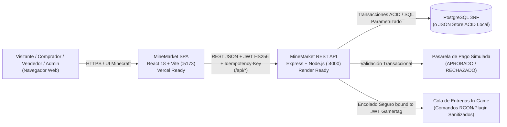
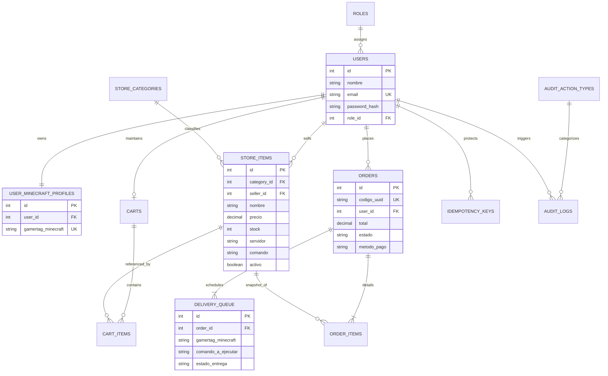
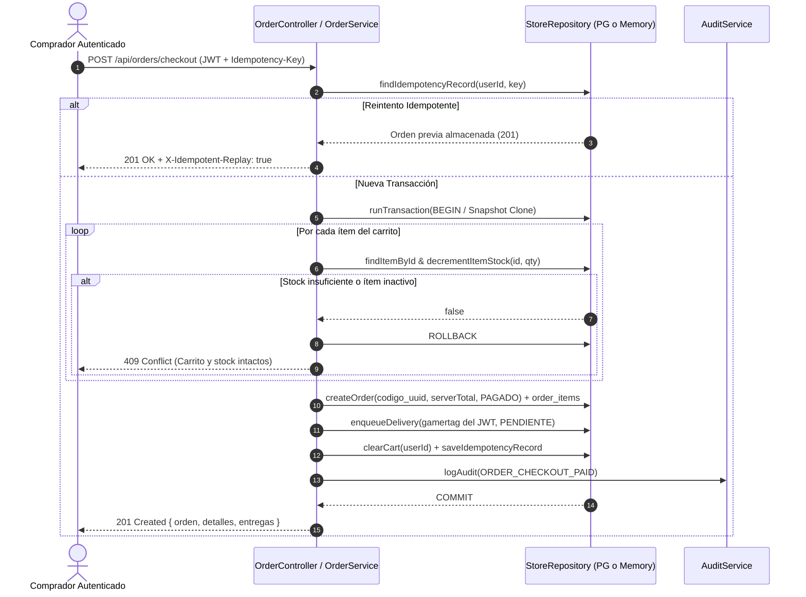
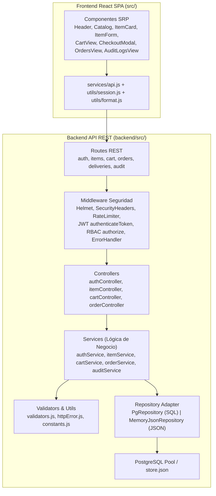

# Arquitectura de Software y Escenarios de Calidad — MineMarket

Este documento presenta las **3 vistas arquitectónicas fundamentales** (Contexto, Información y Componentes/Módulos), el cumplimiento de los **Escenarios de Atributos de Calidad SEI**, las **decisiones de diseño (ADRs)** y los principios de **Clean Code & Patrones SOLID** aplicados en MineMarket.

---

## 1. Vista de Contexto (Diagrama de Contexto y Despliegue)

---

## 2. Vista de Información (Modelo Relacional 3NF y Flujo ACID)

### 2.1 Modelo Entidad-Relación (3NF)

### 2.2 Flujo Transaccional ACID de Checkout (`POST /api/orders/checkout`)

---

## 3. Vista de Componentes y Módulos (Clean Architecture por Capas)

---

## 4. Escenarios de Atributos de Calidad (Modelo SEI de 6 Partes)

| Atributo | Estímulo | Entorno | Respuesta y Medida Verificada |
| :--- | :--- | :--- | :--- |
| **Seguridad e Integridad** (RNF01) | Petición con contraseña débil, auto-asignación de rol `ADMIN`, manipulación de precio/gamertag en checkout o inyección `; rm -rf /` en comando. | Operación normal API REST pública. | Bloqueo inmediato (`400` / `403` / `401`), total calculado exclusivamente en backend, gamertag tomado únicamente desde el claim JWT verificado HS256 (`TTL 2h`), hash BCrypt coste 10 y `DUMMY_BCRYPT_HASH` anti-timing. |
| **Integridad Transaccional** (RNF04) | Checkout concurrente cuando otro usuario agotó el stock de uno de los ítems o reintento de red con la misma `Idempotency-Key`. | Alta concurrencia en carrito/checkout. | `ROLLBACK` atómico (`409`) sin descontar ítems restantes ni vaciar carrito; respuestas idempotentes `X-Idempotent-Replay: true` evitan doble cobro 100% de las veces. |
| **Rendimiento** (RNF02) | 50 usuarios concurrentes consultando `/api/health`, `/api/items` y `/api/cart`. | Carga normal/pico según plan JMeter. | Latencia p95 ≤ 200 ms validada mediante aserciones de duración JMeter y Postman (`responseTime < 200ms`). |
| **Modificabilidad y Portabilidad** | Cambio de almacenamiento local JSON a PostgreSQL 3NF en producción. | Despliegue en Render/Supabase. | Patrón **Repository + Factory (`createStoreRepository`)**: basta configurar `DATABASE_URL` sin modificar controladores, servicios ni UI. |

---

## 5. Patrones de Diseño y Principios SOLID Aplicados

- **Repository + Factory Pattern** (`storeRepository.js`): Abstrae la persistencia intercambiando `MemoryJsonRepository` y `PgRepository` con una interfaz uniforme y transacciones ACID (`runTransaction`).
- **Dependency Injection**: Todos los servicios (`authService`, `itemService`, `cartService`, `orderService`) reciben `repo = storeRepository`, permitiendo pruebas unitarias determinísticas sin acoplarse a disco ni base de datos externa.
- **Chain of Responsibility (Express Middleware)**: `helmet` → `securityHeaders` → `cors` → `apiRateLimiter` → `authenticateToken` → `authorize(...roles)` → `controller` → `errorHandler`.
- **Single Responsibility Principle (SRP)**: Validación (`validators.js`), errores tipados (`HttpError`), reglas de dominio (`services/`), capa HTTP (`controllers/` + `routes/`) y componentes UI están estrictamente desacoplados en funciones pequeñas y cohesivas.
